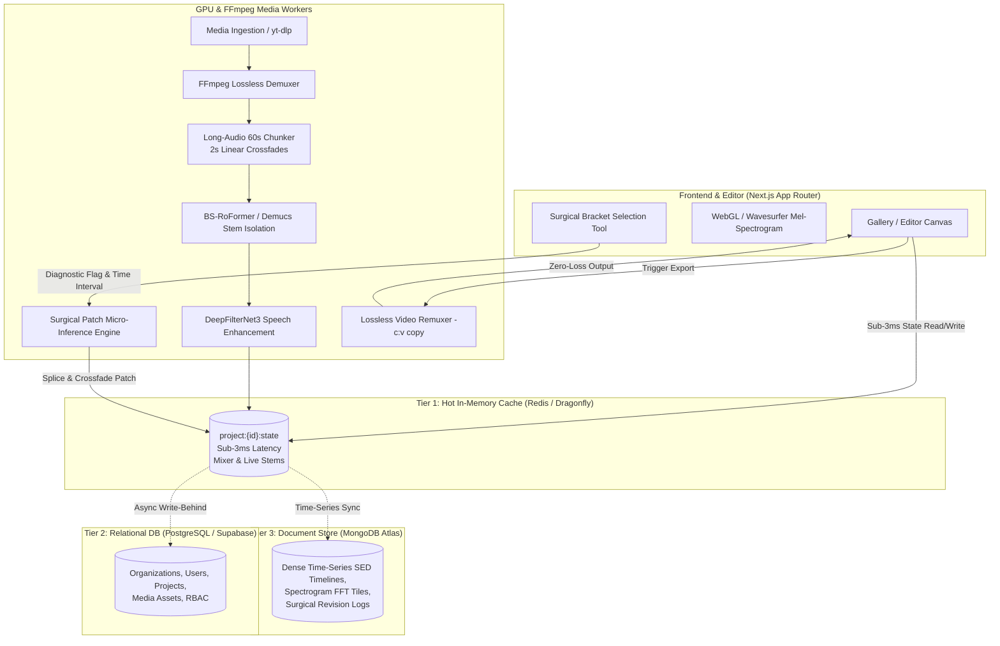

# VoiceWork RSM System Architecture

VoiceWork RSM is an enterprise-grade AI audio separation, video remuxing, and surgical spectrogram editing platform engineered for arbitrary-length media (from 30-minute lectures to 2h+ broadcast streams).

## Data Tier Breakdown

| Tier | Technology | Purpose | SLA / Access Latency |
| :--- | :--- | :--- | :--- |
| **Tier 1: Hot In-Memory** | Redis / Dragonfly (`project:{id}:state`) | Real-time mixer state, live stem playback URLs, active scrub markers, temporary patch coordinates. | `< 3ms` |
| **Tier 2: Relational DB** | PostgreSQL / Supabase | Tenant tenancy, users, billing quotas, media asset inventory, permissions. | `15 - 35ms` |
| **Tier 3: Document Store** | MongoDB Atlas / JSONB | Heavy time-series: dense Mel-spectrogram FFT tiles, Sound Event Detection (SED) timeline intervals, surgical audit history. | `20 - 50ms` |
